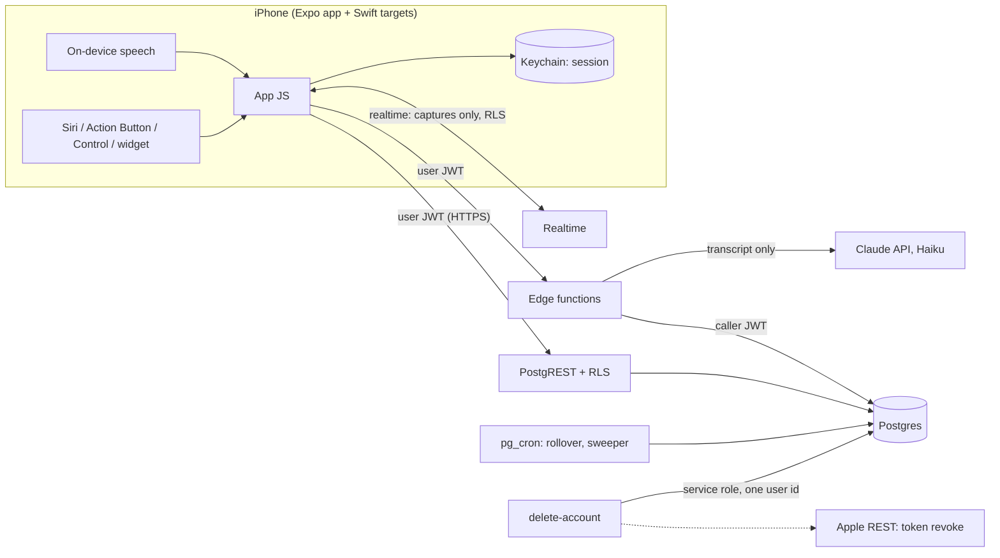

# Tasklings threat model (Phase 0)

Status: Phase 0 security pass, 2026-10-29. Covers the code on `main` as of that date. Gate 1 needs this document published, the RLS tests green, the injection set passing and no open high findings (see "Gate 1 status").

Sources of truth: the Security requirements section of the PRD and the Phase 0 security review (S-01 to S-13). This document maps each boundary to its threats, the controls as built and the tests that prove them, then lists what is still open.

## System

Audio never leaves the phone: speech recognition runs on device (SFSpeechRecognizer with on-device required, English). Only the text transcript is sent.

## Assets

| Asset | Where it lives | Why it matters |
|---|---|---|
| Transcripts and task contents | `captures.transcript`, `tasks.*`, the phone | A running log of someone's day: health errands, family, names, numbers |
| Supabase session | iOS Keychain (`WHEN_UNLOCKED_THIS_DEVICE_ONLY`), chunked | Full access to the user's rows |
| Apple tokens | Not stored (TM-02). The one-time authorization code passes through delete-account memory only; the Apple signing key is a function secret | Exchanged and revoked within one request; never logged or persisted |
| Claude API key | Edge function secret | Cost and abuse |
| Service-role key | Edge function secret, used by `delete-account` and scheduled jobs only | Bypasses RLS |
| Extraction budget | `private.extraction_limits` / `extraction_usage` | Availability for every user |

## Actors

- **Another signed-in user** (the main one to design for): has a valid JWT and the public anon key, can call every endpoint with any IDs.
- **Anyone with the app bundle**: has the project URL and anon key (public by design).
- **Hostile content in a transcript**: text the user dictated or pasted that tries to steer the model (prompt injection). In Phase 1 this becomes third-party email content.
- **Another app on the phone, or a web page**: can open URL schemes and Shortcuts.
- **Someone holding a locked or briefly unlocked phone.**
- **Supply chain**: npm, Deno and GitHub Actions dependencies, Expo's build service.

## Threats and controls by boundary

### 1. Phone ↔ Supabase (user JWT, RLS)

| STRIDE | Threat | Control as built | Proof |
|---|---|---|---|
| S | Forged or replayed sign-in | Sign in with Apple with a nonce (SHA-256 to Apple, raw to Supabase) | `app/src/lib/nonce.ts` tests; full flow lands with US-10 |
| T, E | Write another user's rows, or attach a row to another user's capture/task | RLS on every table; `anon` has nothing; composite FKs `(parent_id, user_id)` because FK checks bypass RLS | `01_rls_privileges.test.sql` |
| T, E | Change lifecycle columns directly (`status`, `planned_for`, …) or `effort_min_initial` | Column grants; lifecycle columns change only inside SECURITY INVOKER RPCs that set a transaction-local flag a trigger checks (PostgREST can't set it) | `02_task_rpcs.test.sql`, `01_rls_privileges.test.sql` |
| T | Delete tasks directly | `DELETE` granted only for `undo_capture`; a trigger rejects deletes without the RPC flag | `06_undo_capture.test.sql` |
| E | Privilege escalation through SECURITY DEFINER | Exactly two definer functions (`handle_new_user`, `reserve_extraction()` with no arguments); a test fails if a third appears | `01_rls_privileges.test.sql` |
| I | Existence oracles (probe other users' IDs) | Task RPCs and `undo_capture` return the same error for "not yours" and "doesn't exist" | `02`, `06` tests |
| I | Realtime leaks | Only `captures` is published (RLS applies); `tasks` removed because DELETE events skip RLS | `07_realtime_publication.test.sql` |
| I | Stolen session on device | Keychain, this device only, readable only while unlocked; no AsyncStorage (lint rule) | `secureSessionStorage` tests |
| R | Destructive actions without the user | export-data and delete-account need a Sign in with Apple under 5 minutes old, measured from `amr` (not `iat`, which moves on refresh) | `auth_test.ts`, `account_test.ts` |

### 2. Edge functions ↔ Postgres and the Claude API

| STRIDE | Threat | Control as built | Proof |
|---|---|---|---|
| E | Function bypasses RLS | Every function queries with the caller's JWT; service role only in `delete-account` (one user id) and cron | `service_role_scope_test.ts` |
| T | Prompt injection makes bad tasks: links, phone numbers, invented tasks, exfiltration of other data | Only the current transcript goes to the model; it is JSON-encoded inside nonce-named tags; the model sees no other user data, so there is nothing to exfiltrate; strict schema validator (exact keys, 0–10 tasks, titles ≤ 60 code points with no URLs, emails, 7+ digit runs, control/zero-width/bidi characters); one retry with codes only; fixed fallback title a note can't shape | 20-note injection set (`ai/evals`), validator unit tests; **live run pending** |
| D | Cost burn | 50 extractions per user and 500 overall per UTC day in the database, not client-settable; at a cap the note saves as a Needs a look task with no model call; counters unreadable → fail closed | `05_extraction_usage.test.sql`, `process_capture_test.ts` |
| D | Oversized input | Bodies capped (64 KiB, process-capture 128 KiB) without trusting Content-Length; transcript ≤ 20,000 characters | function tests |
| I | Sensitive data in logs | Logs carry IDs, codes and counts only; the error object is never logged | code review, `log.ts` |

### 3. Scheduled jobs and APNs

Rollover and the stuck-capture sweeper run in pg_cron as the table owner and touch only lifecycle columns. Push payloads (US-06, not built) must carry counts and IDs only; this is an acceptance criterion of US-06. Proof: `03_rollover.test.sql`.

### 4. Phone-local surfaces

| Threat | Control | Status |
|---|---|---|
| Lock-screen capture shows existing tasks | Entry points open the capture sheet over a neutral view; Today's list renders only after the sheet closes | US-01 entry points PR in progress (TM-03) |
| Another app or web page starts the microphone through a URL scheme | A URL may only open the sheet idle; auto-start only from our own App Intent, signalled in process, never by URL parameter | TM-03 |
| Widget summary readable after first unlock | Accepted for the MVP: one next-up title; revisit before the beta (option: counts only). Decided 2026-10-26 | Accepted risk |
| Export file left on disk | Written to the cache only while the share sheet is open, deleted in `finally` | TM-09 |

### 5. Build and supply chain

GitHub Actions pinned to SHAs; Dependabot with a 7-day cooldown on every ecosystem; gitleaks and Semgrep are required checks; lockfiles committed with exact pins; over-the-air updates are off, so shipped JavaScript changes only through a reviewed build. npm audit triage: `docs/dependency-audit.md` (nothing reaches the shipped app). Expo's build service now builds the Simulator app (TM-07).

## Findings

Severity is for the MVP and a 10-person beta. "Before beta" means before the hosted project is opened to friends.

| ID | Sev | Finding | Recommendation | Status |
|---|---|---|---|---|
| TM-01 | Medium | Sign-up is open to any Apple ID. Ten throwaway accounts at 50 extractions each use up the 500-a-day global cap, so every other user's notes fall back to Needs a look for the rest of the day. | Beta is invite-only: in the hosted project, turn sign-ups off once the friends have joined (no code), or add an Auth "before user created" hook with an allowlist if friends join over time. | Open, before beta |
| TM-02 | Medium | Apple token revocation can't work as designed. Native Sign in with Apple through `signInWithIdToken` never gives the server a refresh token, so `apple_credentials` would stay empty; revocation also needs a client secret signed with the Apple key. App Store rules require revocation on account deletion. | Don't store Apple tokens at all. delete-account already needs a fresh Sign in with Apple; send that sign-in's one-time `authorization_code` with the request, exchange it with Apple server-side and revoke at once, then delete. Drop `apple_credentials`. Owner-approved 2026-10-30 and in the PRD: request `{apple_authorization_code}`; `apple_credentials` dropped. If Apple rejects the code, nothing is deleted (`apple_code_invalid`); if Apple is unreachable or unconfigured, the account is still deleted and the outcome logged. | Fixed in this PR. The real Apple exchange is untested until the paid membership and US-10 |
| TM-03 | Medium | New capture entry points could let another app or a web page open a URL that starts recording, or show tasks on the lock screen. | Requirements set on the US-01 entry-points PR (above); verify in review. | In progress |
| TM-04 | Low | Clients can update their own `captures.status`, `transcript` and `error`, because process-capture runs as the caller and needs those grants. Impact stays inside the user's own rows: caps still apply to every model call, and a duplicate retry is blocked by `hasTasks`. | Accept for the MVP. If it ever matters, move capture status changes into an RPC with the same flag-trigger pattern as tasks. | Accepted |
| TM-05 | Low | Realtime broadcast/presence on public channels is usable by anyone with the anon key as free pub/sub (no data exposure: postgres changes still apply RLS). | In the hosted project, turn off public channel access (private channels only). | Open, before beta |
| TM-06 | Low | `supabase/config.toml` settings (email sign-up off, anonymous off, Apple only, refresh rotation, JWT expiry, `verify_jwt`) apply locally; the hosted project has its own settings. | Hosted-project checklist below, checked when the project is created. | Open, before beta |
| TM-07 | Low | Expo's build service sees the source (public anyway) and, once device builds start, Apple signing credentials if EAS manages them. | Decide when buying the Apple membership: EAS-managed credentials (convenient, Expo holds the distribution certificate) or local builds and manual signing. | Decision at membership |
| TM-08 | Info | The `amr` method name that Supabase records for native Sign in with Apple is assumed to be `oauth` or `id_token`. It fails closed, so the worst case is that export and delete always ask to sign in again. | Verify on the first real sign-in (US-10) and add a test with the real claim shape. | With US-10 |
| TM-09 | Low | The export JSON is briefly a file in the app cache with iOS's default protection class (readable after first unlock). | Accept: it exists only while the share sheet is open. | Accepted |

No high findings are open.

## Hosted project checklist (before beta)

- [ ] Auth: Apple is the only provider; email, phone and anonymous sign-in off; manual linking off.
- [ ] Auth: sign-ups closed after the beta group joins, or an allowlist hook (TM-01).
- [ ] Auth: refresh-token rotation on, reuse interval 10 s, access-token lifetime 1 hour.
- [ ] Realtime: public channel access off (TM-05).
- [ ] API: only `public` exposed; `private` not in the exposed schemas.
- [ ] Edge functions deployed with `verify_jwt = true`; secrets set: Claude API key, `APPLE_TEAM_ID`, `APPLE_KEY_ID`, `APPLE_PRIVATE_KEY` (TM-02; `APPLE_CLIENT_ID` optional); service-role key only where documented.
- [ ] Claude API: a workspace with a spend limit for this app; confirm data retention terms before writing the privacy note.
- [ ] Storage: no buckets (audio never leaves the phone).
- [ ] Backups: note the retention window in the privacy note (deleted accounts persist in backups until then).

## Gate 1 status

| Item | Status |
|---|---|
| Threat model published | This document |
| RLS and cross-user tests green | Green in CI (pgTAP `01`–`07`, edge function tests) |
| Injection set passing | Offline checks green; **live run pending** on the owner's Mac |
| No open high findings | None open |
